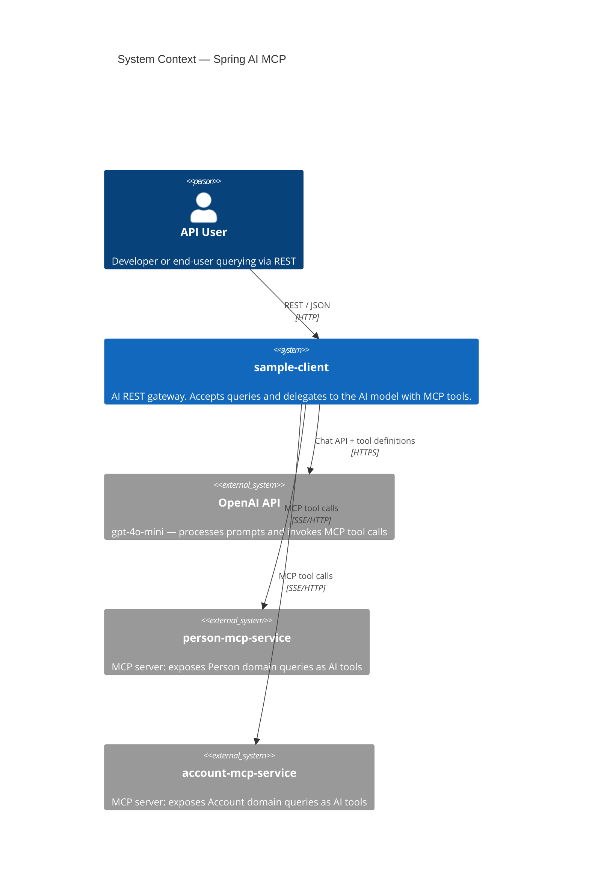
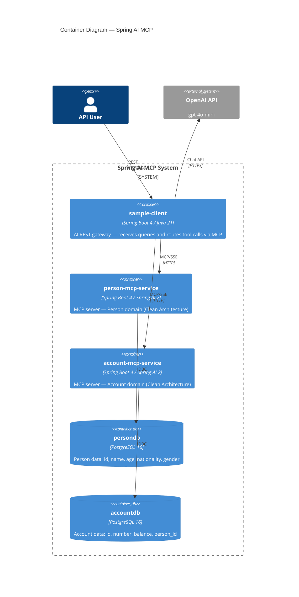

# Spring AI MCP — Clean Architecture

A reference implementation of **Spring AI 2.x with Model Context Protocol (MCP)**, built on Clean Architecture (Hexagonal / Ports & Adapters) principles. The system exposes domain operations as AI tools and orchestrates them through an AI-powered REST gateway.

---

## Architecture

### Visual Diagram

> **[Open interactive diagram on Excalidraw](https://excalidraw.com/#json=iTU5bAovQMlHn2sZ4JY-0,xMF1kI_JZ5D2Hm6LfesR6Q)**

---

### C4 Level 1 — System Context



---

### C4 Level 2 — Containers



---

### C4 Level 3 — Clean Architecture per Service

Each MCP service follows Hexagonal Architecture (Ports & Adapters):

```
interfaceadapters/mcp/         ← MCP Adapter       (@Tool — entry point for AI tool calls)
usecases/                      ← Application       (Use Case ports + Application Services)
entities/                      ← Domain            (Aggregates, Value Objects, Exceptions)
interfaceadapters/persistence/ ← Infrastructure    (Repository Adapter, Spring Data JPA)
frameworks/                    ← Spring Boot entry point
```

---

## Modules

| Module | Port | Responsibility |
|---|---|---|
| `person-mcp-service` | 8060 | MCP server — Person domain queries |
| `account-mcp-service` | 8040 | MCP server — Account domain queries |
| `sample-client` | 8080 | AI REST gateway consuming both MCP servers |

### MCP Tools exposed

**person-mcp-service**
- `getPersonById(id)` — Find a person by their unique identifier
- `getPersonsByNationality(nationality)` — List all persons by nationality

**account-mcp-service**
- `findAccountsByPersonId(personId)` — List all accounts belonging to a person

### REST Endpoints (sample-client)

| Method | Path | Description |
|---|---|---|
| GET | `/api/v1/persons/nationality/{nationality}` | AI query: persons by nationality |
| GET | `/api/v1/persons/count-by-nationality/{nationality}` | AI reasoning: count persons |
| GET | `/api/v1/accounts/count-by-person/{personId}` | AI query: account count |
| GET | `/api/v1/accounts/balance-by-person/{personId}` | AI aggregation: total balance |

---

## Tech Stack

| Technology | Version | Role |
|---|---|---|
| Java | 21 | Language |
| Spring Boot | 4.1.2 | Framework |
| Spring AI | 2.0.2 | MCP client/server, AI integration |
| PostgreSQL | 16 | Database |
| Flyway | 10.20.1 | Database migrations |
| MapStruct | 1.6.3 | DTO mapping |
| Lombok | 1.18.34 | Boilerplate reduction |
| Testcontainers | 1.20.3 | Integration testing |
| Helm | 3.x | Kubernetes packaging |
| KinD | latest | Local Kubernetes cluster |

**AI Providers supported:** OpenAI (default) · Ollama (local) · LiteLLM gateway

**Code quality:** Checkstyle · SpotBugs · PMD · JaCoCo (≥70% coverage) · SonarCloud

---

## Prerequisites

- Java 21+
- Maven 3.8+
- Docker Desktop (with ≥ 6 GB RAM allocated)
- [KinD](https://kind.sigs.k8s.io/) — `choco install kind` or `brew install kind`
- [Helm](https://helm.sh/) — `choco install kubernetes-helm` or `brew install helm`
- OpenAI API key **or** [Ollama](https://ollama.com/) with a model pulled

---

## Running Locally

### Option 1 — OpenAI (default)

```bash
./deploy-all.sh --openai-key sk-xxxxxxxx
# or via environment variable
OPENAI_API_KEY=sk-xxxxxxxx ./deploy-all.sh
```

### Option 2 — Ollama (host machine)

```bash
# Pull a model first
ollama pull llama3.1

./deploy-local-ollama.sh
# Custom model: ./deploy-local-ollama.sh --ollama-model mistral
```

### Option 3 — Full in-cluster (Ollama + LiteLLM + Kong)

Requires Docker Desktop with ≥ 8 GB RAM.

```bash
./deploy-local-gateway.sh
# All traffic routed through Kong on http://localhost:8000
```

Each script:
1. Creates a KinD cluster (`spring-ai-mcp`)
2. Builds Maven artifacts (`mvn package -DskipTests`)
3. Builds Docker images and loads them into KinD
4. Deploys via Helm

### Health checks

```bash
curl http://localhost:8060/actuator/health  # person-mcp-service
curl http://localhost:8040/actuator/health  # account-mcp-service
curl http://localhost:8080/actuator/health  # sample-client
```

### Example queries

```bash
curl http://localhost:8080/api/v1/persons/nationality/Germany
curl http://localhost:8080/api/v1/accounts/balance-by-person/1
```

### Teardown

```bash
helm uninstall spring-ai-mcp -n spring-ai-mcp
kind delete cluster --name spring-ai-mcp
```

---

## Running Tests

```bash
# Unit + integration tests (requires Docker for Testcontainers)
mvn verify

# Single module
mvn verify -pl person-mcp-service
```

Minimum code coverage enforced by JaCoCo: **70%**.

---

## Database Schema

**persondb**

```sql
CREATE TABLE persons (
    id          BIGSERIAL PRIMARY KEY,
    first_name  VARCHAR(100) NOT NULL,
    last_name   VARCHAR(100) NOT NULL,
    age         INTEGER NOT NULL CHECK (age > 0),
    nationality VARCHAR(100) NOT NULL,
    gender      VARCHAR(10) CHECK (gender IN ('MALE', 'FEMALE'))
);
```

**accountdb**

```sql
CREATE TABLE accounts (
    id        BIGSERIAL PRIMARY KEY,
    number    VARCHAR(30) NOT NULL,
    balance   INTEGER NOT NULL DEFAULT 0 CHECK (balance >= 0),
    person_id BIGINT NOT NULL
);
```

Migrations are managed by Flyway (`src/main/resources/db/migration/`).

---

## Project Structure

```
spring-ai-mcp-clean/
├── person-mcp-service/     # MCP server — Person domain
├── account-mcp-service/    # MCP server — Account domain
├── sample-client/          # AI REST gateway
├── helm/spring-ai-mcp/     # Helm chart for Kubernetes deployment
├── docs/
│   ├── c4/                 # C4 architecture diagrams (PlantUML)
│   └── sequence/           # Sequence diagrams (PlantUML)
├── postman/                # Postman collection
├── deploy-all.sh           # Deploy with OpenAI
├── deploy-local-ollama.sh  # Deploy with local Ollama
├── deploy-local-gateway.sh # Deploy with Kong + LiteLLM + Ollama
├── kind-config.yaml        # KinD cluster definition
└── pom.xml                 # Maven multi-module root
```

---

## Architecture Diagrams

PlantUML source files are located in `docs/`:

- `docs/c4/01-context.puml` — System context (C4 Level 1)
- `docs/c4/02-container.puml` — Containers (C4 Level 2)
- `docs/c4/03-component-person.puml` — Person service components (C4 Level 3)
- `docs/sequence/find-person-by-id.puml` — Request flow through Clean Architecture layers
- `docs/sequence/balance-by-person.puml` — Account balance aggregation flow

---

## License

This project is provided as a portfolio reference implementation.
